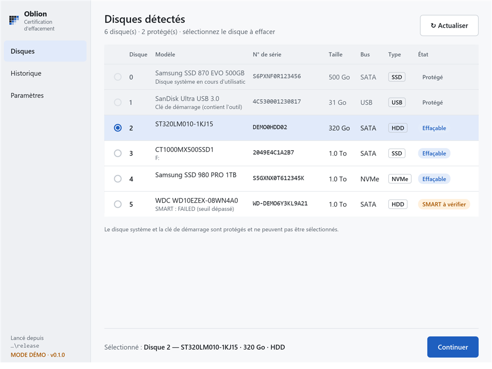
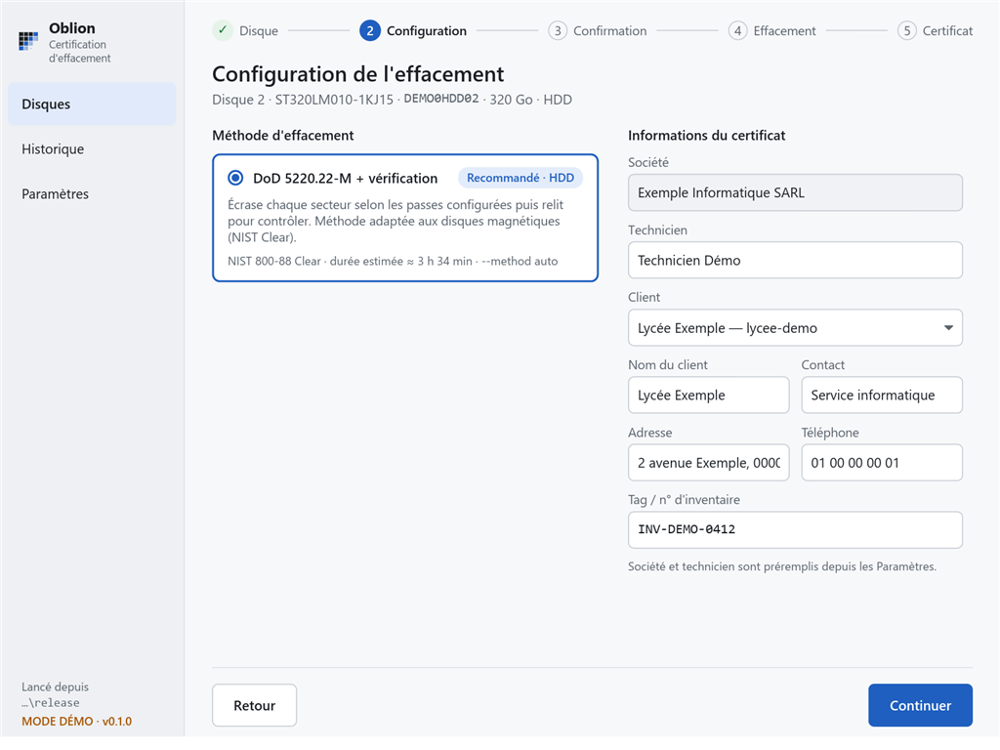
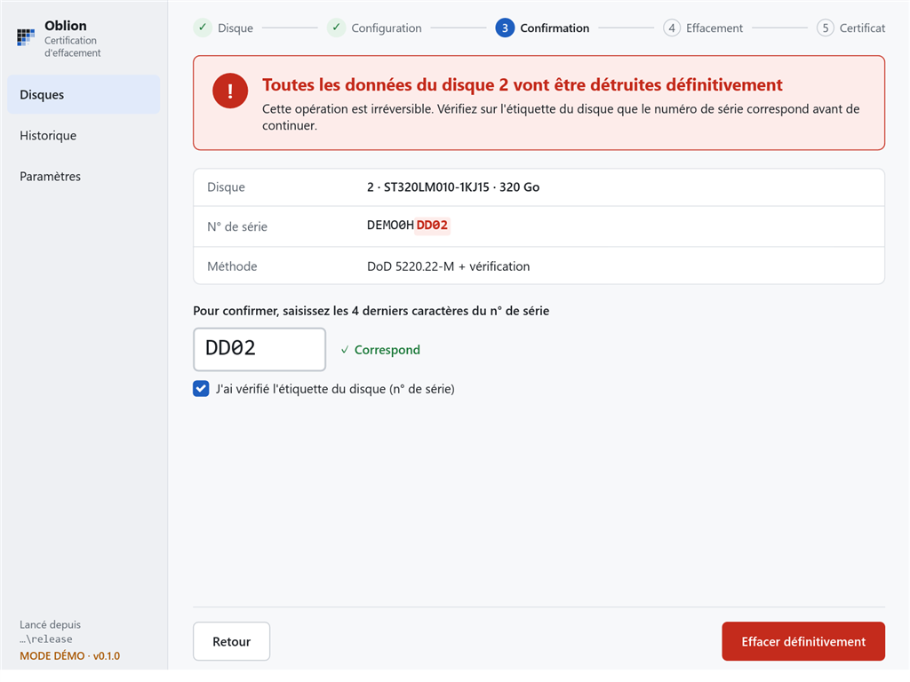
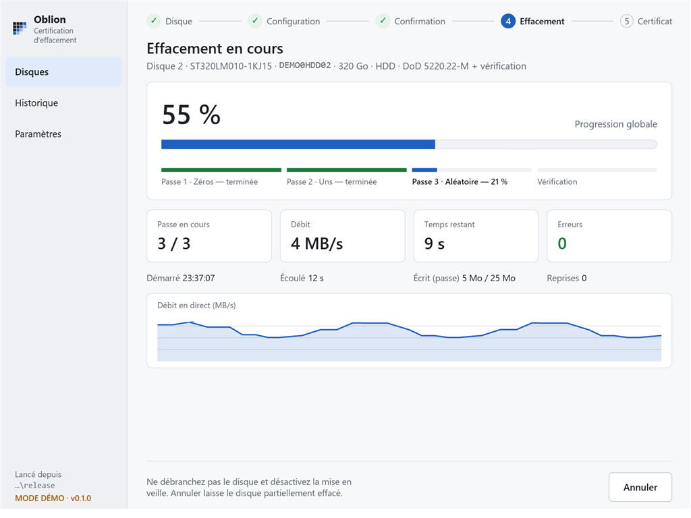
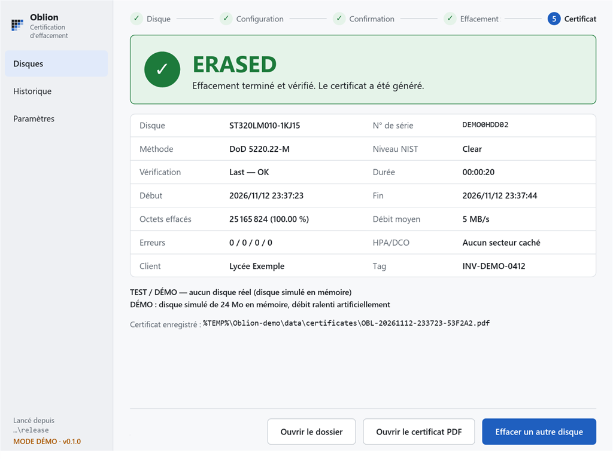
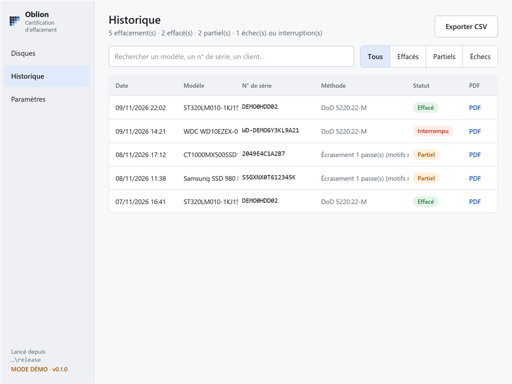
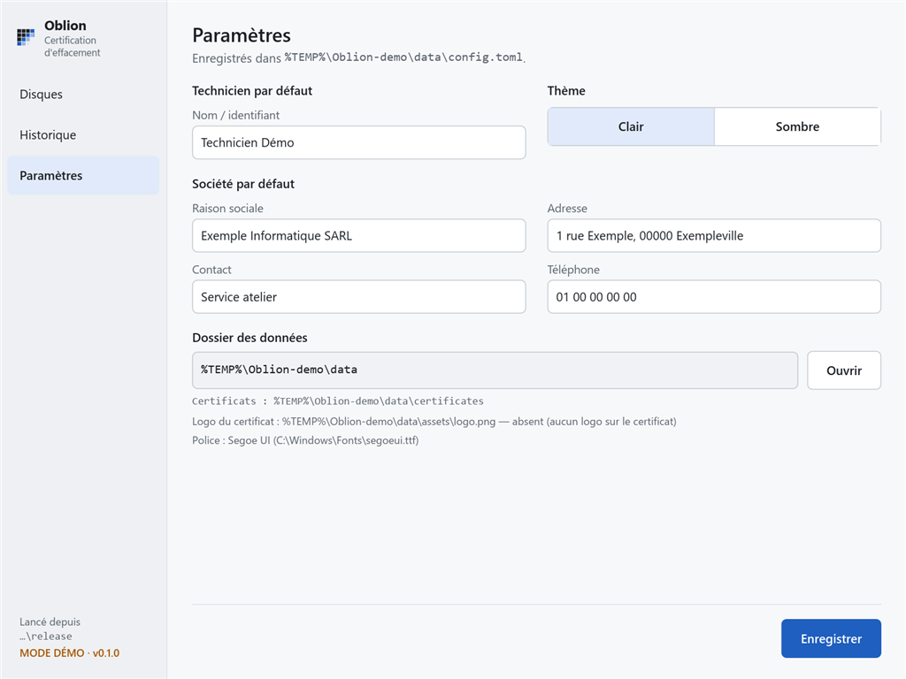

<p align="center"></p>

# Oblion

> ⚠️ **Outil destructif** : il efface définitivement les disques. Fourni tel quel, sans aucune
> garantie ; l'auteur décline toute responsabilité en cas de perte de données (voir [LICENSE](LICENSE)).
> État des tests : effacement validé sur disque virtuel (VHD) ; pas encore validé sur du matériel physique.
>
> ⚠️ **Destructive tool** — it permanently wipes disks. Provided as is, without any warranty; the author
> accepts no liability for data loss. Validated on a virtual (VHD) disk, not yet on physical hardware.



## Français

Outil Windows portable (sans installation, compatible WinPE / Medicat) pour effacer des disques
durs, SSD SATA et NVMe, puis générer un certificat PDF d'effacement inspiré du rapport nwipe.
Projet étudiant (BTS SIO). Anciennement « DiskErase ».

### Deux exécutables

| Fichier | Rôle |
|---|---|
| `oblion.exe` | Interface graphique (rendu logiciel, **aucun GPU requis** : fonctionne sous WinPE) |
| `oblion-cli.exe` | Mode console : scripts, codes de retour, WinPE minimal (aucune DLL graphique) |

Les deux appellent exactement le même code d'effacement et les mêmes sécurités.

### Ce que fait l'outil

- Détection des disques, **disque système et clé de démarrage protégés** (refus si la protection
  ne peut pas être établie), confirmation par le n° de série, `--dry-run`.
- **HDD** : Sanitize ou Security Erase (Purge) si le disque le supporte, sinon écrasement
  DoD 5220.22-M (0x00, 0xFF, aléatoire) avec vérification et reprise sur erreur (Clear).
- **SSD SATA** : ATA Sanitize (Crypto Scramble / Block Erase), sinon Security Erase.
- **NVMe** : Sanitize (Crypto / Block Erase), sinon Format NVM sécurisé.
- Disque « gelé » (frozen) détecté : rien n'est tenté, l'opérateur est guidé.
- SMART (ATA et NVMe), détection HPA/DCO (sans modification).
- Certificat PDF 2 pages (QR, code-barres, ID unique, SMART, profil de débit), historique JSON, export CSV,
  carnet de clients.

### Niveaux NIST 800-88

- Un **écrasement** vaut **Clear**, jamais Purge.
- **Purge** n'est indiqué que si la commande firmware a réussi **et** que la vérification par
  marqueurs le confirme (motif aléatoire écrit sur ~1000 secteurs avant, aucun ne doit subsister après).
- La vérification par marqueurs est un échantillonnage ; on suppose, comme la norme ACS, que
  Sanitize couvre aussi les zones cachées HPA/DCO.
- Le statut du certificat est **calculé** à partir des résultats ; il ne peut pas être saisi à la main.

### Conseils

- Branchez le disque **en direct** (SATA ou NVMe sur la carte mère) : la plupart des adaptateurs USB
  et certains pilotes RAID / Intel RST bloquent les commandes d'effacement firmware. Tout refus est
  indiqué sur le certificat.
- Lancez en **administrateur**.
- L'exécutable n'est pas signé : SmartScreen / le Contrôle intelligent des applications peuvent le
  bloquer (désactivation temporaire, ou lancement depuis Medicat / WinPE).
- Security Erase (ATA) impose un mot de passe temporaire (`DiskErase`), retiré automatiquement ;
  il est indiqué sur le certificat si le retrait échoue.

### Utilisation en console

```
oblion-cli --list
oblion-cli --info N
oblion-cli --erase N --confirm XXXX --dry-run
oblion-cli --erase N --confirm XXXX --client exemple --tag INV-001
oblion-cli --history
oblion-cli --export-csv historique.csv
```

`XXXX` = 4 derniers caractères du n° de série. `oblion.exe --gui-demo` ouvre l'interface en mode
démonstration (disques simulés, aucun accès disque).

### Configuration

Tout est relatif au dossier de l'exécutable (`data/`), rien n'est écrit ailleurs :
- `data/config.toml` : votre société et le technicien par défaut ;
- `data/clients.toml` : carnet de clients ;
- `data/assets/logo.png` : logo affiché sur le certificat (optionnel) ;
- `data/assets/fonts/` : police `.ttf` optionnelle si le système n'en a pas (WinPE minimal).

### Captures

| | |
|---|---|
|  |  |
|  |  |
|  |  |

### Compilation

```
cargo test
cargo build --release
```
Cible `x86_64-pc-windows-msvc`, CRT liée statiquement (aucun runtime Visual C++ requis).

Ce projet n'utilise pas le code de nwipe (GPLv2) : seule la structure du rapport sert de référence.

## English

Portable Windows tool (no install, WinPE / Medicat friendly) to wipe HDDs, SATA SSDs and NVMe drives
and produce a PDF erasure certificate. `oblion.exe` is the GUI (software rendering, no GPU needed),
`oblion-cli.exe` the console version. Overwrites are reported as NIST 800-88 **Clear**; **Purge** is only
reported after a successful firmware sanitize command confirmed by marker verification. MIT licensed.
